<p align="center">
  <picture>
    <source media="(prefers-color-scheme: dark)" srcset="assets/readme/logo-dark.png">
    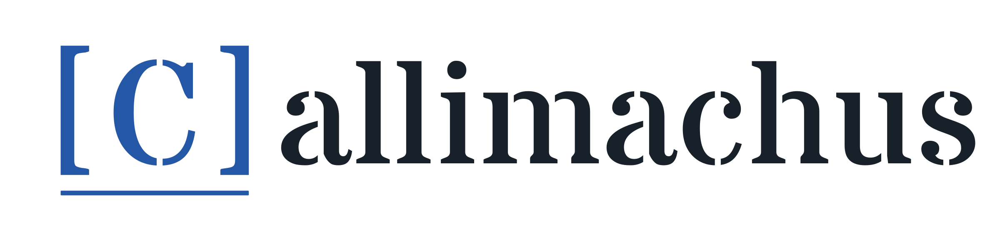
  </picture>
</p>

<p align="center"><strong>Citation Verifier</strong></p>
<p align="center">Check whether your sources support what you wrote.</p>

<p align="center">
  <a href="https://callimachus.science/">Website</a> ·
  <a href="#native-desktop-releases">Downloads</a> ·
  <a href="#quick-start">Quick start</a> ·
  <a href="#desktop-workspace">Desktop</a> ·
  <a href="examples/report/index.html">Example report</a> ·
  <a href="#what-it-checks">What it checks</a> ·
  <a href="docs/README.md">Documentation</a>
</p>

<p align="center"><strong><a href="https://apps.microsoft.com/detail/9pf67kq4543z">Get Callimachus for Windows from Microsoft Store</a></strong></p>
<p align="center"><sub>Install and receive updates through Microsoft Store. Linux, macOS and standalone Windows packages are available from <a href="https://github.com/SNatangelo/Callimachus/releases/latest">GitHub Releases</a>.</sub></p>

A reference can be real and still fail to support the sentence that cites it.

**Callimachus checks a manuscript against its cited sources.** It identifies references, retrieves available text, and assesses whether that text supports the claims. Callimachus 2 brings manuscript review, source retrieval, model selection and reports into one desktop workspace, with the same tools available through the CLI.

**Manuscript formats:** Word (`.docx`), LaTeX, PDF, Markdown, plain text, and HTML.

## Desktop workspace

Drop a manuscript onto **Analysis**, choose the models for your juries, and start a check. Follow progress, search and filter sources, and open a source to inspect its findings. Light and dark themes, adjustable text size, resizable panels and compact navigation let you keep the material you are reviewing in view.

<a href="assets/readme/desktop-analysis-light.png">
  <picture>
    <source media="(prefers-color-scheme: dark)" srcset="assets/readme/desktop-analysis-dark.png">
    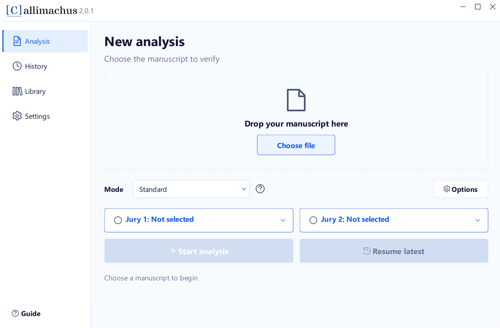
  </picture>
</a>

*Actual application screens with synthetic demonstration data; they illustrate the interface, not verification results. [Light theme](assets/readme/desktop-analysis-light.png) · [Dark theme](assets/readme/desktop-analysis-dark.png). See [published packages](#native-desktop-releases) for available release versions.*

### Review sources and continue work

Source details separate **technical retrieval problems** from **Jury assessments**. Read the explanation and quoted passages, check the available evidence scope, and inspect recorded attempts without treating a missing result as a verdict.

When a run needs input, review citation mappings, supply a document through **Guided Fetch**, or resolve a source-identity question in the app. Eligible scans can be queued for OCR. A paused run retains its progress; **History** lets you resume it, reopen its report, or create a new verification run while keeping the earlier record.

<a href="assets/readme/desktop-verification-light.png">
  <picture>
    <source media="(prefers-color-scheme: dark)" srcset="assets/readme/desktop-verification-dark.png">
    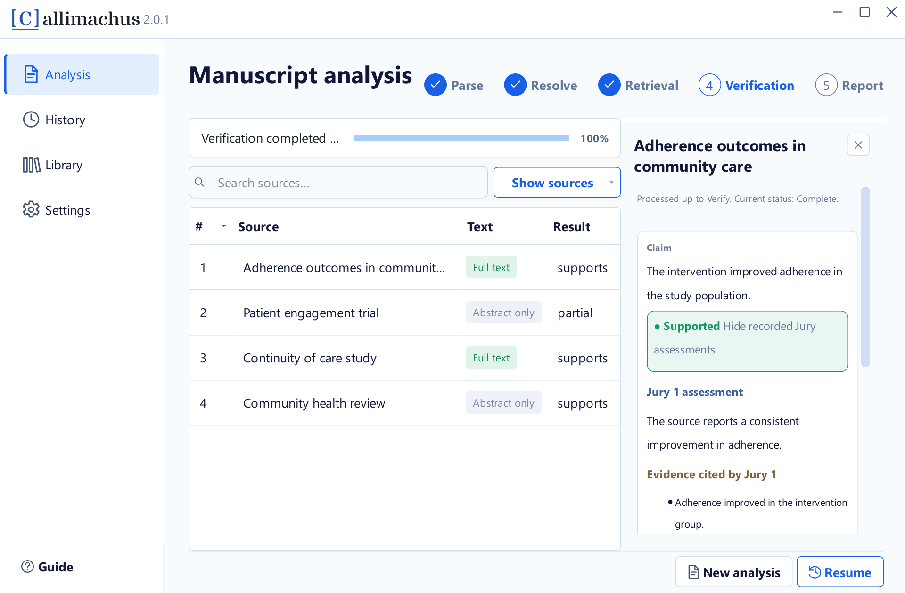
  </picture>
</a>

*[Light theme](assets/readme/desktop-verification-light.png) · [Dark theme](assets/readme/desktop-verification-dark.png). [Reviews and sources](docs/user/en/04-reviews-and-sources.md) · [Results and History](docs/user/en/05-results-and-history.md).*

<details>
<summary><strong>Guided Fetch and citation review, in both themes</strong></summary>

<picture>
  <source media="(prefers-color-scheme: dark)" srcset="assets/readme/desktop-fetch-dark.png">
  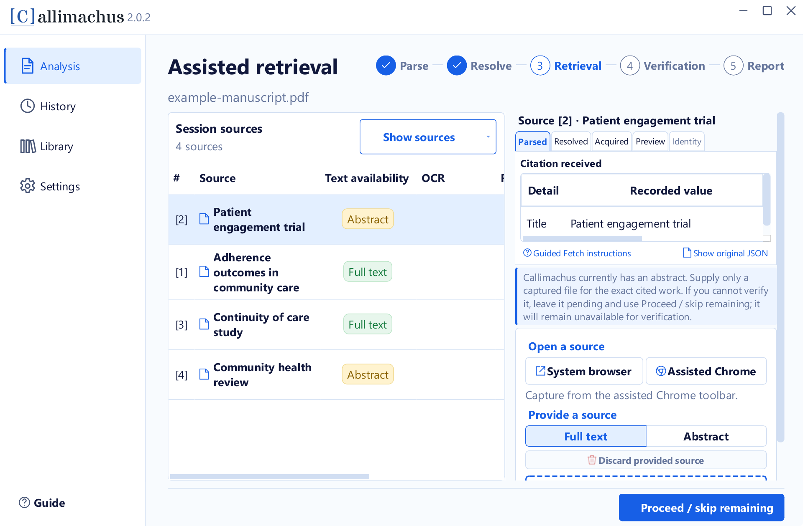
</picture>

*Guided Fetch — [Light theme](assets/readme/desktop-fetch-light.png) · [Dark theme](assets/readme/desktop-fetch-dark.png).*

<picture>
  <source media="(prefers-color-scheme: dark)" srcset="assets/readme/desktop-review-dark.png">
  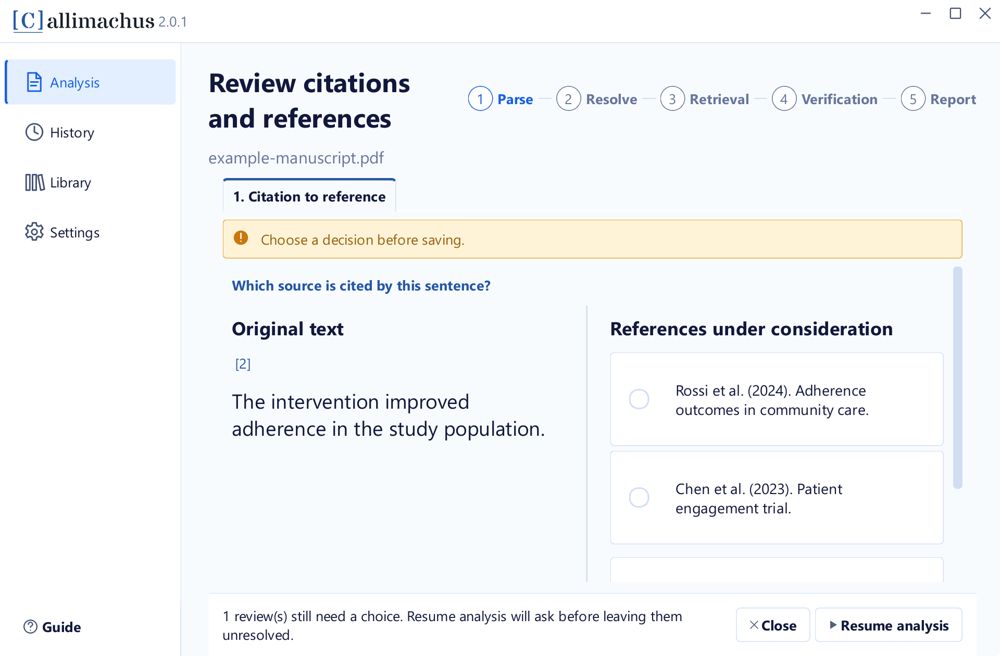
</picture>

*Citation review — [Light theme](assets/readme/desktop-review-light.png) · [Dark theme](assets/readme/desktop-review-dark.png).*

</details>

### Build a reusable source library

Import papers from files or a folder, review their identity, and save approved items to **Library**. Import follows the enabled document readers, including PDF, Word, LaTeX, Markdown, plain text and HTML. You can correct metadata or look it up by identifier before saving; the original document bytes are preserved alongside reusable text.

Search and filter the library across stored entries, then export a portable ZIP or import a previous library backup. Library archives include originals, reusable texts and metadata; **they are not encrypted**. Removing reusable cache entries leaves existing runs and their recorded evidence intact.

<a href="assets/readme/desktop-library-light.png">
  <picture>
    <source media="(prefers-color-scheme: dark)" srcset="assets/readme/desktop-library-dark.png">
    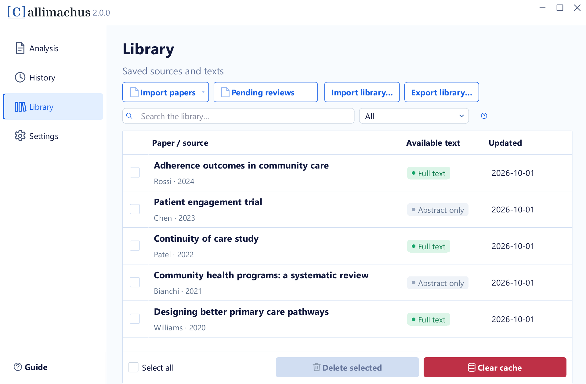
  </picture>
</a>

*[Light theme](assets/readme/desktop-library-light.png) · [Dark theme](assets/readme/desktop-library-dark.png). [Library and cache](docs/user/en/06-library-and-cache.md).*

### Choose models and keep settings under your control

Configure a provider, use **Check**, then explicitly assign models to **Jury 1** and **Jury 2** for claim verification. Their selections are independent and remain selected across app sessions. Discovering additional models does not select them for you. You can also choose a references-only check without model-based claim verification.

Use supported API providers, compatible endpoints, or separately installed native CLI clients such as Codex CLI and Claude Code. Local Ollama uses its running loopback service without an API key. FreeToken also needs a separately installed, running service and an explicit model; it is currently unavailable in the macOS Jury chooser. CLI clients use their own login and must meet the supported version and isolation requirements. See [Configuration](docs/reference/03-configuration.md#registered-backends) for backend details and limitations.

Compiled desktop apps save credentials in Windows Credential Manager, macOS Keychain or Linux Secret Service. **Settings** keeps service configuration, appearance and report-integrity controls together. Settings export/import is separate from Library backup and offers password encryption; an unencrypted settings export can contain secrets. Source launches retain dotenv storage. See [Settings](docs/user/en/03-settings.md) and [Keys and credentials](docs/reference/10-keys-and-credentials.md).

<details>
<summary><strong>Model chooser and Settings, in both themes</strong></summary>

<a href="assets/readme/desktop-jury-light.png">
  <picture>
    <source media="(prefers-color-scheme: dark)" srcset="assets/readme/desktop-jury-dark.png">
    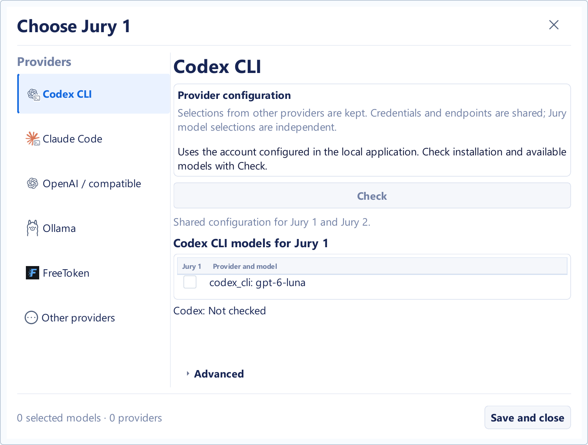
  </picture>
</a>

*Model chooser — [Light theme](assets/readme/desktop-jury-light.png) · [Dark theme](assets/readme/desktop-jury-dark.png).*

<a href="assets/readme/desktop-settings-light.png">
  <picture>
    <source media="(prefers-color-scheme: dark)" srcset="assets/readme/desktop-settings-dark.png">
    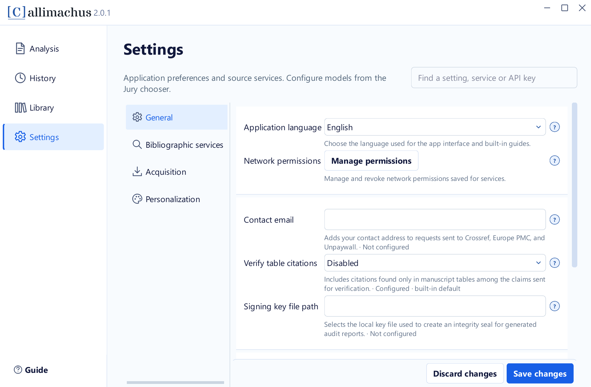
  </picture>
</a>

*Settings — [Light theme](assets/readme/desktop-settings-light.png) · [Dark theme](assets/readme/desktop-settings-dark.png).*

</details>

The desktop's **Console** also runs CLI tools and retains output for inspection or export. You can use the graphical workflow or the [command-line interface](docs/reference/02-cli-reference.md) with the same pipeline and durable run records.

## What it checks

| Question | What Callimachus checks |
|---|---|
| **Is this the right source?** | Whether the reference can be identified and whether retrieved text belongs to the cited work. |
| **Does it support the claim?** | The relationship between the cited claim and the available source text, including partial support, contradictions, and uncertainty. |
| **Are there bibliography issues?** | Common plain-text deviations from the selected style, kept separate from source identity and claim support. |

A formatting error does not make a source irrelevant. A valid DOI does not make a claim supported. These findings stay separate. Bibliography checks are heuristic, not a complete check against a style manual or of in-text citation formatting.

## The report

Open **`report.html`** in your browser. Start with the overview, filter claims and sources, then open an assessment to inspect its explanation, evidence, and model-attempt history. The report is self-contained and includes English and Italian interface options.

Use **Export** from Analysis or History to create a redacted public copy of an eligible completed report. The export retains the recorded findings while removing material according to the public-export rules; review the copy before sharing. The original run and report remain unchanged.

<p align="center">
  <a href="assets/readme/report-overview.png">
    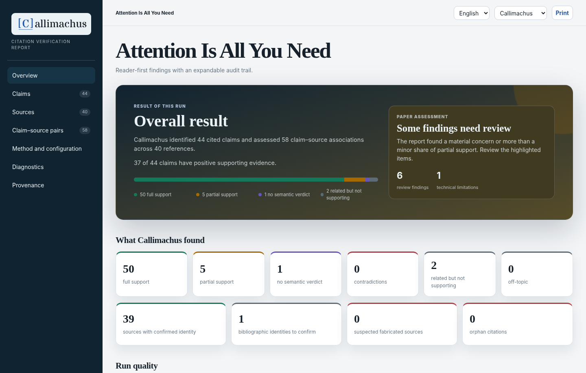
  </a>
</p>
<p align="center"><sub>An actual test run on <em>Attention Is All You Need</em>: 44 cited claims, 40 bibliography entries, 58 claim–source associations.</sub></p>

**[Explore the self-contained example report](examples/report/index.html)** without installing Callimachus. Download that file and open it in your browser to inspect the bundled version offline. On GitHub, use the file page's download button.

The bundled example is a public derivative of a test report. It retains the claim and verdict excerpts, omits nonessential source text and prompt payloads, and records the transformation in a [redaction manifest](examples/report/index.html.redaction.json). Its Dropout citation year is corrected in the public copy, with the changed fields listed in that manifest. It demonstrates the interface, not measured accuracy or independently attested audit readiness. See the [example notes](examples/report/README.md).

### From a claim to its evidence

An expanded assessment shows the claim and source, the verdict, what was supported, what was not, and the source passage used. In the example below, the run returned **partial support** rather than a blanket pass or fail.

<p align="center">
  <a href="assets/readme/report-detail.png">
    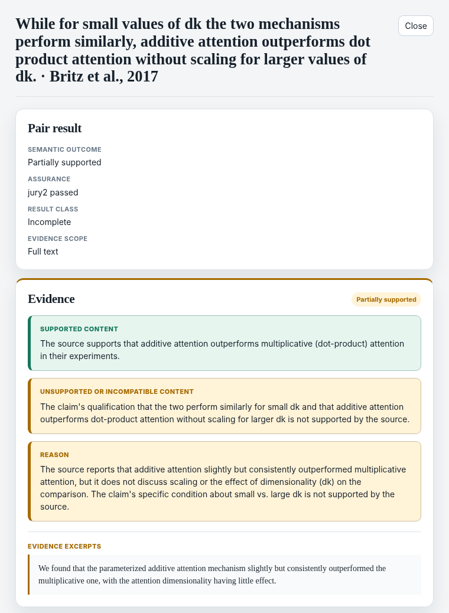
  </a>
</p>

Claim-support assessments distinguish **supports**, **partial**, **contradicts**, **related**, **off_topic**, and **non_decidable**. A missing semantic result is also shown explicitly. An abstract is not presented as a full-text review, and missing text is not evidence of support.

For support, partial support, or contradiction, quoted evidence is checked against the stored source text. This checks that the passage is present; its interpretation remains an LLM judgment. See [verification and evidence](docs/reference/06-verification-and-evidence.md).

### Follow a reference through retrieval

Open a source to compare **what was searched**, **what the resolver found**, and **the text acquired for verification**. The panel records available identifiers, providers, extraction details and identity checks, followed by the resolution and acquisition histories.

<details>
<summary><strong>See the source-identity and retrieval view</strong></summary>

<p align="center">
  <a href="assets/readme/report-source.png">
    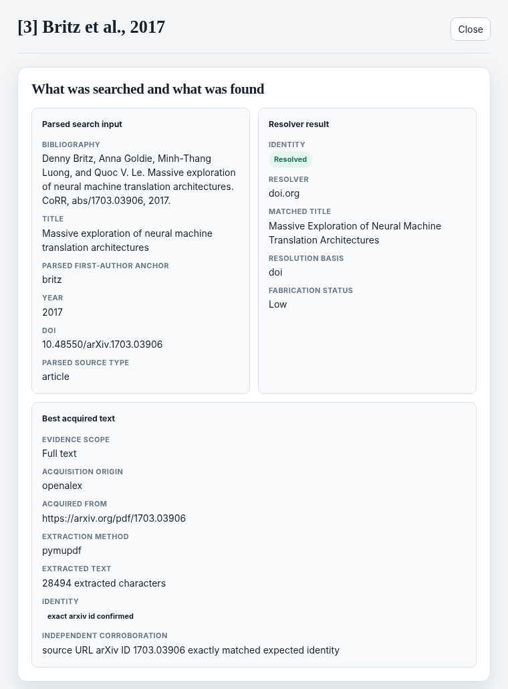
  </a>
</p>

</details>

**Rejected attempts stay visible.** Where present, Jury 1 proposals rejected by the guards and Jury 2 reviews are shown separately from the final result, with model attribution and candidate cycles. Full reports include their recorded reasons and request payloads; the public example omits some reasons and payloads while retaining the attempt timeline and safe status fields.

<details>
<summary><strong>The files behind the report</strong></summary>

Each run retains the underlying record alongside the browser report.

| Output | Use it to… |
|---|---|
| `report.html` | Browse findings and inspect the evidence. |
| `report.md` | Read the canonical report in Markdown. |
| `run.sqlite` | Inspect the structured run history and audit ledger. |
| `sources/` | Inspect retained inputs and normalised source evidence. |
| `report.journal.md`, `report.signature_status.md` | Review report history and seal status. |

</details>

## Quick start

The commands below run from source and use dotenv. Compiled desktop 2.0 uses
`settings.conf` for non-secret settings and the native OS vault for saved
credentials, with bundled `settings.defaults`; old `.env` files are not migrated.
See [Desktop packages](docs/user/en/09-desktop-packages.md#settings-and-credentials-in-20).

You need **Python 3.9+**, network access to retrieve sources, and **one configured LLM backend** for claim-support assessment. You can run Callimachus directly; an external agent is not required.

### 1. Install

Clone this repository using its **Code** menu, or download and extract its ZIP. Open a terminal in the resulting project directory, then run the commands for your platform below.

<details open>
<summary><strong>macOS / Linux</strong></summary>

```bash
python3 -m venv .venv
. .venv/bin/activate
python -m pip install -r requirements.txt
cp .env.example .env
```

</details>

<details>
<summary><strong>Windows / PowerShell</strong></summary>

```powershell
python -m venv .venv
.\.venv\Scripts\python.exe -m pip install -r requirements.txt
Copy-Item .env.example .env
```

Use `.\.venv\Scripts\python.exe` in place of `python` in the commands below. This uses the virtual environment without requiring script activation.

</details>

### 2. Choose a model backend

Edit `.env`. For example, with the direct OpenAI API backend:

```dotenv
CITATION_VERIFIER_VERIFY_BACKENDS=openai
CITATION_VERIFIER_VERIFY_JURY2_LEVEL=medium
CITATION_VERIFIER_MODEL=<supported-model-id>
OPENAI_API_KEY=<your-api-key>
```

Replace the placeholders with your model ID and API key. Callimachus loads `.env` automatically. Keep credentials out of version control.

The `medium` setting selects the second-judge enforcement policy. Other policies, HTTP backends, and authenticated CLI backends are covered in [configuration](docs/reference/03-configuration.md), [verification and evidence](docs/reference/06-verification-and-evidence.md#jury2-policy), and [keys and credentials](docs/reference/10-keys-and-credentials.md).

For a local, credentialless backend, start a separately installed FreeToken
server and select the model it serves:

```dotenv
CITATION_VERIFIER_VERIFY_BACKENDS=freetoken
CITATION_VERIFIER_VERIFY_JURY2_LEVEL=medium
FREETOKEN_HOST=http://127.0.0.1:1919
FREETOKEN_MODEL=<served-model-id>
```

Callimachus does not install or start FreeToken. See the
[FreeToken setup instructions](docs/reference/10-keys-and-credentials.md#run-a-local-freetoken-server-without-an-api-key)
for the server command and model-ID check. For other HTTP or authenticated CLI
backends, follow [Configuration](docs/reference/03-configuration.md). For exact
key-creation and storage steps, see
[Keys and credentials](docs/reference/10-keys-and-credentials.md).
Every setting in `.env.example` is explained in the
[Environment reference](docs/reference/11-environment-reference.md).

### 3. Check a manuscript

```bash
python run.py --input manuscript.pdf --accuracy standard
```

Replace `manuscript.pdf` with your input file. Progress appears in the terminal, and the run is saved under `runs/<id>/`. Open **`report.html`** there after the report has been generated.

To launch the desktop from the same source environment, install its dependencies:

```powershell
.\.venv\Scripts\python.exe -m pip install -r requirements-gui.txt
.\.venv\Scripts\python.exe run.py app
```

On macOS or Linux, use `python run.py app` after installing the same GUI
requirements with `python -m pip`.

### Native desktop releases

For Windows, [install Callimachus from Microsoft Store](https://apps.microsoft.com/detail/9pf67kq4543z) to receive updates through the Store. Automatic updates follow your Microsoft Store settings; you can also check for updates in the Store. GitHub packages are updated separately and may be released at a different time.

Check the [public Callimachus Releases page](https://github.com/SNatangelo/Callimachus/releases/latest) for the versions and platform packages currently published.
For a Windows installer release, run `Callimachus-Setup.exe`;
it checks for the Microsoft Visual C++ runtime and offers to install or update
it from Microsoft if missing or too old. Alternatively, extract the entire
Windows ZIP and run `Callimachus.exe` if that runtime is already installed.
On macOS and Linux, extract the whole archive and start `Callimachus.app` or
`Callimachus`.
Python and the application's Python libraries are included. Google Chrome
remains an external requirement for Guided Fetch's browser capture. Each
archive includes the Callimachus license, actual
third-party notices, and a SHA-256 file; the matching source is published with
the release. See [Desktop packages](docs/user/en/09-desktop-packages.md) for
configuration locations, platform caveats, and release verification.

The desktop uses the same pipeline and durable run database as the command-line
workflow. It opens Guided Fetch in the same application if Fetch pauses for
operator input. Select a configured LLM model before starting a full run;
without one, the application runs only Parse and Resolve and produces a
references-only report.
Select **Finish without manual review** to waive pending manual Fetch work and
keep sources needing an identity decision unverified. It also disables
interactive browser challenges for that run; automatic checks still run. The
final HTML report opens automatically and remains available from the
Analysis screen. **Resume latest** is disabled when the latest run is complete;
use the explicit History action to start a new verification run from it.

<details>
<summary><strong>When a run needs a source or an operator decision</strong></summary>

A paused run retains its progress. List pending tasks and inspect the relevant task:

```bash
python run.py tasks list --run runs/<id> --status pending
python run.py tasks show --run runs/<id> --task <task-id>
```

Follow [tasks and recovery](docs/reference/05-tasks-and-recovery.md) to supply the required answer, then resume:

```bash
python run.py --run runs/<id> --resume
```

</details>

The [complete quick start](docs/reference/01-quickstart.md) covers the first run in more detail.

## How it works

```text
Your manuscript → Citation mapping → Source retrieval → Claim assessment → Report
```

Underneath, the Python driver runs five stages: `parse → resolve → fetch → verify → report`.

**The model assesses the evidence; the driver controls the record.** LLMs propose bounded judgments and evidence passages. Deterministic code controls source admission, quote grounding, phase transitions, persistence, and report generation. A model response cannot directly write an accepted result into the final report.

Unresolved references, unavailable text, rejected evidence, and uncertain judgments remain recorded. A completed run means its required records and checks are complete—not that every citation passed.

See the [pipeline guide](docs/reference/04-pipeline.md) and [verification contract](docs/reference/06-verification-and-evidence.md) for the technical details.

### Running with an agent

Callimachus also works through an LLM harness such as Codex or Claude Code. The harness follows the [skill contract](SKILL.md) and [procedure](PLAYBOOK.md), while the same Python driver controls the run.

<details>
<summary><strong>Audit-ready deployment</strong></summary>

Standalone runs are fully functional but recorded as `standalone_unattested`, not audit-ready. Audit-ready agent-assisted runs require the [isolated integrity authority](docs/deployment/agent-guide.md) and a stable `--agent-identity`. That deployment boundary is separate from ordinary installation.

</details>

## Practical limits

**Source access varies.** Retrieval depends on available text, provider access, and credentials. You can supply a source copy through the documented task workflow. Callimachus does not bypass paywalls or access controls.

**Extraction and assessment have limits.** PDF/OCR extraction is best effort; ambiguous citation markers may need input. Table-only citations are excluded from semantic verification by default. Grounded quotations do not guarantee a correct semantic judgment.

**Local execution does not mean offline processing.** Source retrieval and remote model backends make external requests. The configured backend determines where model requests go.

The [capabilities and limits guide](docs/reference/08-capabilities-and-limits.md) documents supported formats, providers, evidence scopes, and operational boundaries.

## Documentation

| Looking for… | Start here |
|---|---|
| Your first complete run | [Quick start](docs/reference/01-quickstart.md) |
| Commands, options, and exit codes | [CLI reference](docs/reference/02-cli-reference.md) |
| Models, accuracy settings, and credentials | [Configuration](docs/reference/03-configuration.md) · [Keys and credentials](docs/reference/10-keys-and-credentials.md) |
| Paused runs and missing sources | [Tasks and recovery](docs/reference/05-tasks-and-recovery.md) |
| Verdicts and evidence checks | [Verification and evidence](docs/reference/06-verification-and-evidence.md) |
| Audit records and signatures | [Artifacts and provenance](docs/reference/07-artifacts-and-provenance.md) |
| Errors and troubleshooting | [Troubleshooting](docs/reference/09-troubleshooting.md) |
| Every environment setting | [Environment reference](docs/reference/11-environment-reference.md) |

[Browse the full guide](docs/README.md).

## Licence and contributions

Callimachus project code, tests and accompanying documentation are available under the GNU Affero General Public License, version 3 only ([AGPL-3.0-only](LICENSE)), except where a component is expressly identified otherwise.

Contributions require acceptance of the [Contributor License Agreement](CLA.md). Contributors retain their copyright and permit alternative licensing, including paid proprietary licences, subject to the CLA's public-licence commitment. See [CONTRIBUTING.md](CONTRIBUTING.md).

For alternative licensing enquiries, contact **hello@callimachus.science**. Commercial use that complies with the AGPL does not, merely because it is commercial, require a paid licence. See [LICENSING.md](LICENSING.md).

